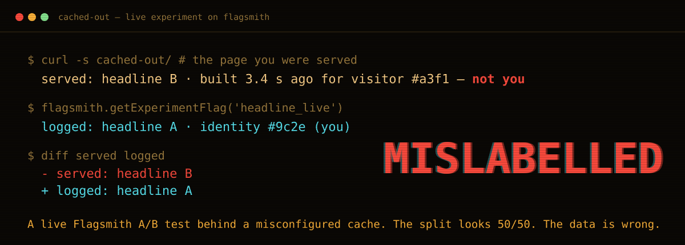
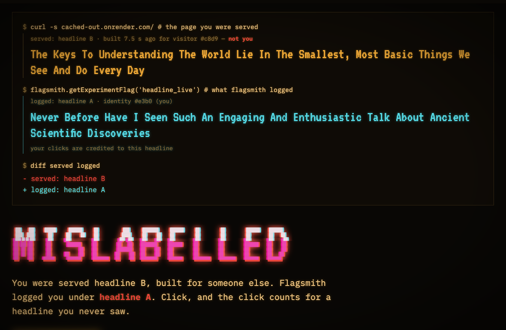
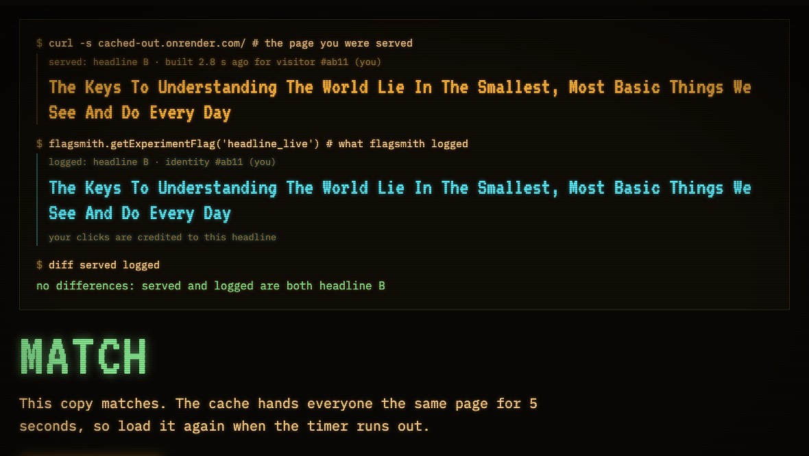
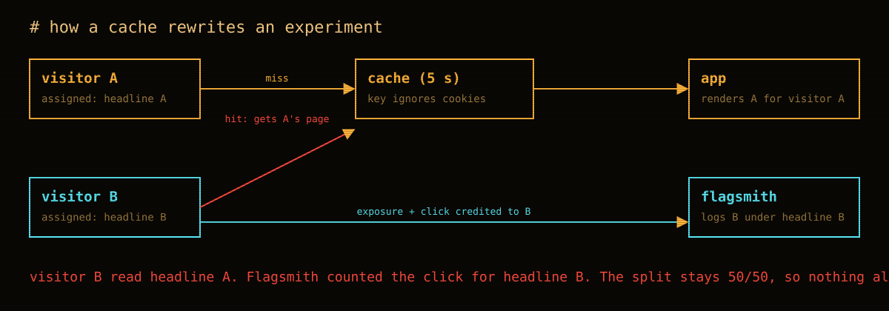
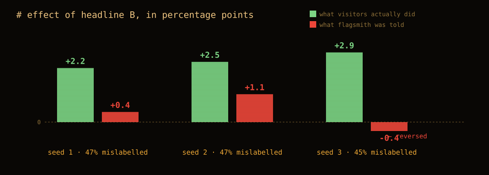
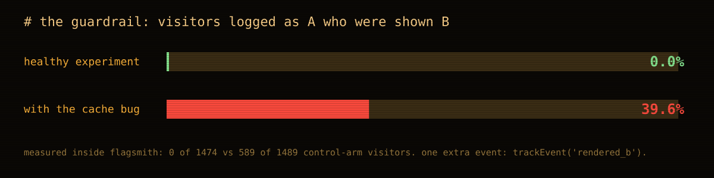

<p align="center"></p>

<h1 align="center">Cached Out</h1>
<p align="center"><b>A cache quietly corrupted a Flagsmith A/B test. The split looked perfect. The winner was the loser.<br>Here is the proof, a live demo you can break yourself, and the one-event fix.</b></p>

<p align="center">
<a href="https://cached-out.onrender.com"></a>


</p>

---

## In 30 seconds

- **The problem:** a shared cache serves one visitor's page to the next. People read headline A while Flagsmith logs them under headline B. **45–47% of exposures were mislabelled** in every seed we ran.
- **The damage:** a real effect of **+2.9 points** reached Flagsmith as **−0.4**. Flagsmith gave the better headline a **37.4%** chance to win, and a team would have shipped the worse one.
- **Why nobody notices:** the split stays a perfect 50/50, so a sample-ratio check has nothing to catch.
- **The fix:** one extra event. A `rendered_b` guardrail metric reads **0%** when healthy and **39.6%** under the bug, inside Flagsmith.
- **Try it:** [open the live demo](https://cached-out.onrender.com), reload twice, then flip the giant switch. It is the real Flagsmith flag that turns the bug on and off.

<p align="center"></p>
<p align="center">


</p>
<p align="center"><i>Left: the cache handed this visitor someone else's page. Right: the same visitor after the giant switch turned the bug off.</i></p>

## The scorecard, answered

| Judging criterion | The evidence |
|---|---|
| **Use of Flagsmith** | 16 experiments with multivariate flags, two metrics (conversion plus guardrail), Bayesian results read through the API, a boolean flag used as a **live kill switch** flipped through the **Admin API**, the JS and Node SDKs, and CLI v2 for every setup call. [How Flagsmith is used ↓](#how-flagsmith-is-used) |
| **Impact** | Any team running experiments on cached, server-rendered pages can hit this, and nothing in the dashboard warns them. It happened to Upworthy: a cache serving one version at a time may have affected **7,004 of their tests (22%)** in 2013. The guardrail is one line of code. |
| **Creativity** | The experiment tests the *experiment*. A planted ground truth makes the corruption measurable, and the live page lets every visitor see whether they were mislabelled, then fix it for everyone with one switch. |
| **Demo** | A public live site with real traffic. Every visit is logged at `/ledger.csv`. |
| **Track 1: clear hypothesis** | [`EXPERIMENT.md`](EXPERIMENT.md), committed at 13:22 IST **before any data**, plus five amendments, each committed before its own data |
| **Track 1: versions behind a flag** | Headline A (`control`) and headline B (`b`), two real Upworthy headlines, served by multivariate flags at a 50/50 split |
| **Track 1: metric from real events** | `headline_click` via `trackEvent`; exposures via `getExperimentFlag`; guardrail `rendered_b` |
| **Track 1: results you can explain** | Flagsmith's numbers sit next to an independent oracle ([`analysis/oracle.py`](analysis/oracle.py)) and a per-visitor ledger. Every figure in this README is generated from the committed data ([`analysis/make_figures.py`](analysis/make_figures.py)). |

## How a cache rewrites an experiment

<p align="center"></p>

The trigger is ordinary. nginx's default cache key ignores cookies, and the app sends `Cache-Control: public, max-age=5`. On the live site, a Flagsmith flag controls that header, so you can switch the bug on and off and watch it happen.

## What it did to a controlled experiment

We used 3,000 simulated visitors per run with a **planted effect**: a visitor clicks with probability 10% if it *saw* headline A, and 13% if it saw B. Because we know the true answer, we can check exactly what Flagsmith was told.

<p align="center"></p>

| Run | Setup | Result |
|---|---|---|
| r1 | No cache | The truth comes through: 94.9% chance to win in seed 1, 99.0% in seed 2 |
| **r2** | **Shared cache that ignores cookies** | **45–47% mislabelled, a balanced split, the effect shrunk in two seeds and reversed in the third** |
| r3 | The same bug, but the page logs what it actually rendered | The estimate is right, but the split only breaks by luck (SRM p = 2e-13 in seed 1, 0.44 in seed 2) |
| r4 | r2 with one config line removed | The fix: 92.9% in seed 1, 100% in seed 2 |

Flagsmith's exposure and conversion counts matched our ledger in every run we checked. The pipeline worked; it was told the wrong thing.

## The fix: one event

```js
const flag = flagsmith.getExperimentFlag('my_flag');   // records the exposure
if (renderedVariant === 'b') flagsmith.trackEvent('rendered_b');   // the guardrail
```

Attach `rendered_b` to the experiment as a second metric. In a healthy experiment, nobody logged as A ever sees B.

<p align="center"></p>

Anything above 0% means people are seeing a variant they weren't assigned, whether from a cache, a CDN or a server/client rendering mismatch.

## We also found a Flagsmith bug

`srm_p_value` came back `null` on all 16 experiments, including a deliberate 240/60 imbalance. That matches open issue [Flagsmith/flagsmith#9128](https://github.com/Flagsmith/flagsmith/issues/9128): SRM is null when variant weights are 0, and the documented experiment setup creates variants with weight 0. Our independent chi-square SRM is in [`RESULTS.md`](RESULTS.md).

## Honest limits

- The controlled runs use simulated visitors with a planted effect; that is what makes the truth checkable. The live site adds real traffic.
- At 1,500 visitors per arm, a 2–3 point effect sits near the edge of detection, so the clean runs crossed 95% in some seeds and not others. We report both. The evidence is the mislabelling rate and the shrunken effect, not a single "no winner".
- Our oracle's chance-to-win differs from Flagsmith's by 1–2 points because it uses a different model. Every decision uses Flagsmith's own numbers.
- The two Upworthy headlines are real, but they were nearly tied in the archive (20 vs 21 clicks), so the effect is planted rather than taken from it.

## Pre-registration trail

| Commit | Locked in before the data |
|---|---|
| `51dae44` | Hypothesis, runs, sample size, predictions, decision rules |
| `970df07` | Amendment 1: how SRM is reported |
| `dddd24c` | Amendment 2: one replication, reported whatever it showed |
| `f60d5e6` | Amendment 3: the guardrail |
| `bdb518e` | Amendment 4: the live site with real visitors |

## How Flagsmith is used

| Flagsmith feature | Where |
|---|---|
| Multivariate flags with keyed variations | one per run, plus `headline_live` on the live site |
| Experimentation: conversion plus guardrail metrics, Bayesian results API, managed warehouse | [`scripts/full_run.sh`](scripts/full_run.sh), [`results/`](results) |
| Boolean flag as a live kill switch, flipped through the Admin API | `cache_bug_on`, [`live/server.js`](live/server.js) |
| JS SDK: `getExperimentFlag`, `trackExposureEvent`, `trackEvent`, `flushEvents` | the page |
| Node.js SDK: evaluation with no exposure, plus traffic | server and [`bot/`](bot) |
| CLI v2 (`flagsmith api`) | every flag, metric, experiment and results call |

## Run it yourself

Requirements: Docker, Node 20+, Python 3 with numpy and pandas, Flagsmith CLI v2, and an environment with Experimentation.

```bash
cp .env.example .env                                   # client-side and server-side keys
npm install
python3 analysis/pick_upworthy.py data/upworthy.csv    # Upworthy exploratory CSV from OSF (jd64p)
./scripts/full_run.sh v1 20261127                      # flags, experiments, 4 × 3,000 visitors, results
python3 analysis/oracle.py v1 && python3 analysis/make_figures.py
docker build -f live/Dockerfile -t cached-out-live . && docker run --rm -p 8090:8080 --env-file .env cached-out-live
./scripts/capture.sh http://localhost:8090             # re-records docs/demo-live.gif and the screenshots
```

## Repository map

`live/` the public demo · `app/` and `edge/` the controlled app and its four caches · `bot/` simulated visitors and the SRM probe · `analysis/` oracle and figures · `scripts/` setup, runs and capture · `data/` per-visitor ledgers · `results/` raw Flagsmith results · `docs/` figures and recordings

## Credits

Headlines come from the Upworthy Research Archive (J. Nathan Matias, Kevin Munger, Marianne Aubin Le Quere, Charles Ebersole), CC BY 4.0. Built for **Toggle Wars**, Track 1. MIT license.
